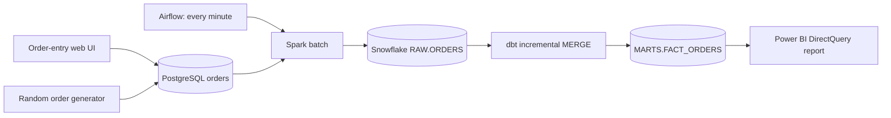

# Minute Market: a one-minute retail ELT learning demo

Pretend you run three coffee shops in Chicago. You want to watch revenue, transaction count, average basket size, and sales by store as purchases arrive. Customers place orders in a separate local web app. Those orders first land in PostgreSQL. Airflow moves them through Spark and Snowflake, then runs dbt. Power BI reads the resulting Snowflake facts.

This is a local learning project. All purchases are fictional. The source code contains plain-language comments explaining the main decisions.

## The journey of one order



1. A user submits an order at `http://localhost:8000`. The API validates its store, product, quantity, and discount, looks up its price on the server, and inserts it into PostgreSQL.
2. The row starts with `delivered_at = NULL`. That means it is waiting to be sent. PostgreSQL commits the row before the UI confirms the purchase.
3. Airflow schedules `retail_every_minute` at each minute boundary. Only one run may be active at a time.
4. Spark reads up to 5,000 undelivered orders through PostgreSQL JDBC. It removes duplicate IDs and standardizes the timestamp and column names. This demo intentionally keeps business calculations in dbt.
5. The Snowflake Python connector stages the bounded Spark result using `write_pandas`. A Snowflake `MERGE` inserts transaction IDs that are not already present in `RAW.ORDERS`.
6. Only after the Snowflake merge succeeds does the loader mark the PostgreSQL rows as delivered.
7. Airflow runs `dbt build`. The staging view reads RAW. The incremental fact model calculates gross revenue, discount amount, and net revenue. Tests check keys, required fields, and correct amounts.
8. Power BI DirectQuery asks Snowflake for the current facts when its visuals refresh. Keep the active report page on a one-minute automatic page refresh.

Example: two coffees at $4.50 each with a 10% discount produce $9.00 gross revenue, $0.90 discount, and $8.10 net revenue.

## What “every minute” means

Airflow starts a new batch every minute. This is a micro-batch pipeline, not streaming. Spark startup, loading, dbt, and report queries take additional time. Power BI refreshes on its own clock. An order placed just after a batch starts can wait for the next batch and then the next report refresh. Expect roughly one to two minutes plus processing time, rather than a guaranteed 60-second end-to-end deadline.

If a batch runs longer than a minute, `max_active_runs=1` prevents overlapping writes. The UI shows how many orders are waiting. The Power BI “Latest Order ID” card helps you confirm the particular order you submitted has reached the report.

## Files to read first

| File | What it teaches |
|---|---|
| `app/main.py` | Input validation, safe SQL inserts, and random purchase generation |
| `app/index.html` | The separate order-entry and simulator UI |
| `postgres/init.sql` | Source schema and the durable delivery queue |
| `pipeline/load_orders.py` | Reading PostgreSQL with Spark and loading Snowflake safely |
| `dags/retail_minute.py` | One-minute scheduling, task order, and retries |
| `dbt/models/marts/fact_orders.sql` | Incremental filtering and merging by transaction ID |
| `dbt/tests/valid_order_amounts.sql` | A business-data quality check |
| `sql/snowflake_setup.sql` | Warehouse, schemas, users, and restricted roles |
| `scripts/build_powerbi.py` | A commented generator for Power BI model/report JSON |
| `compose.yaml` | How the three local services run together |

## Prerequisites

- Docker Desktop running with Linux containers. Allow enough memory for PostgreSQL, Java/Spark, and Airflow; 6–8 GB available to Docker is a practical starting point.
- PowerShell and Git for Windows (its OpenSSL utility generates the service key).
- A Snowflake account with permission to run the one-time setup as `ACCOUNTADMIN`.
- Power BI Desktop. The supplied project uses PBIP/PBIR source files and a Snowflake DirectQuery model.
- Internet access for the first image build and for Snowflake.
- At least 10 GB of free disk space for image downloads, build layers, and data.

Airflow, Spark, and dbt Core run locally. They require no hosted vendor subscriptions. Snowflake still requires authentication and consumes warehouse credits. An X-Small warehouse queried every minute can remain active continuously. Stop the demo and close the Power BI report when finished.

## First-time setup

Open PowerShell in the project root. On this machine the project is under the chat's `outputs/retail-elt-demo` folder.

### 1. Create local settings

The `.env` file has already been created for the current machine. For a fresh clone:

```powershell
Copy-Item .env.example .env
```

Fill in your account identifier and your existing setup username. The warehouse/database/schema names are demo defaults created by the setup SQL. Do not create them manually in advance.

The actual `.env`, generated keys, and Power BI local caches are excluded from Git. `.env.example` documents the expected settings without real credentials.

### 2. Prepare and review Snowflake setup

```powershell
# Use the Snowflake username returned by CURRENT_USER(), which can differ from a login email.
.\scripts\Prepare-Snowflake.ps1 -ReportUsername 'your_actual_snowflake_username'
```

This generates `secrets/snowflake_key.p8`, its public key, and `secrets/setup.sql`. It does not connect to Snowflake. The private key is restricted to your Windows user and excluded from Git and the Docker build context. The running containers mount the project locally so they can read the key.

Review `secrets/setup.sql`, then run its statements in a Snowsight SQL file as `ACCOUNTADMIN`. It creates:

- `ELT_WH`: an X-Small warehouse with 60-second auto-suspend and auto-resume.
- `RETAIL_DEMO.RAW`, `STAGING`, and `MARTS`.
- `ELT_SERVICE` with key-pair authentication and a restricted `ELT_ROLE`.
- `RETAIL_REPORTER` with read-only access to reporting objects, granted to your interactive user.

Do not reuse these generic names for unrelated existing objects. The setup uses `IF NOT EXISTS`; it does not erase existing data. Registering the generated key updates the named service user's key, so retain this key for later starts.

After the SQL succeeds:

```powershell
.\scripts\Use-ServiceAccount.ps1
```

This changes `.env` to use `ELT_SERVICE` and `ELT_ROLE`. The pipeline never needs `ACCOUNTADMIN`.

### 3. Start the local demo

```powershell
.\scripts\Start-Demo.ps1
```

The script builds the Docker image, tests the service account against Snowflake, and starts PostgreSQL, the UI, and Airflow. It waits for the UI and scheduler health checks before reporting that startup succeeded. The first build downloads several large packages and can take several minutes. Airflow and dbt have separate Python environments inside the image to avoid dependency conflicts.

Open:

- Order UI: [http://localhost:8000](http://localhost:8000)
- Airflow: [http://localhost:8080](http://localhost:8080)

Airflow login and job:

1. **Username:** `demo`
2. **Password:** `demo_local_only`
3. **DAG:** `retail_every_minute`

After signing in, select `retail_every_minute` and open **Grid** to review each one-minute run. Each run shows the Spark loading task followed by the dbt models and tests. Green means the task succeeded; click a task to read its logs.

The PostgreSQL username/password in Compose and the Airflow login are deliberately local demo values. Ports are bound to `127.0.0.1`. Do not expose this setup on a shared network.

### 4. Make the first order and wait for dbt

Place a manual order in the UI. Save its order ID. The next Airflow run should show two successful tasks. That first run creates the reporting table Power BI needs.

You can also trigger an immediate run while learning:

```powershell
docker compose exec airflow airflow dags trigger retail_every_minute
```

The simulator initially stays off. Click **Start automatic orders** to generate one purchase every five seconds (or change the interval). Click it again to stop.

## Connect Power BI Desktop

The generated project lives at `powerbi/RetailDemo.pbip`. Its semantic model uses Snowflake DirectQuery against `RETAIL_DEMO.MARTS.FACT_ORDERS`; its report includes revenue, transaction count, average basket, latest order ID, revenue over time, store comparison, and order detail.

1. Open `powerbi/RetailDemo.pbip` in Power BI Desktop after the first dbt run succeeds. If Desktop requires its project-format preview setting, enable the relevant PBIP/PBIR feature and restart when prompted.
2. Authenticate the Snowflake source when Desktop asks. If you normally sign into Snowflake with Google and have no password, choose **KeyPair**, enter username **ELT_SERVICE**, and select the local file `secrets/snowflake_key.p8`. This demo key is unencrypted, so no key passphrase is needed. The setup grants this user `RETAIL_REPORTER`, and the report activates that read-only role. Power BI keeps credentials locally, not in the Git project. A Google browser login does not automatically authenticate Power BI. You must complete the authentication dialog yourself.
3. The source settings are the account's server hostname, warehouse `ELT_WH`, and role `RETAIL_REPORTER`. The report generator fills the server for this machine. For another account, run `python scripts/build_powerbi.py --server your-account.snowflakecomputing.com` before opening it.
4. Select the report's blank canvas. In the page formatting pane, open **Page refresh**, enable **Auto page refresh**, and set its interval to **1 minute**. Save the project. Keep the report page active during the demo.
5. Place another manual order in the UI. After the Airflow run and the next automatic page refresh, find the same ID in the report. This verifies the complete path.

The one-minute interval applies to the active Desktop report page. A published report in shared/Pro capacity has a 30-minute minimum automatic page refresh. Faster published refresh needs appropriate capacity and administrator settings. This demo targets the installed Desktop app, not pinned Power BI service dashboard tiles.

If opening a generated project fails, the manual equivalent is **Get data → Snowflake**, specify the server and `ELT_WH`, choose **DirectQuery**, and select `RETAIL_DEMO → MARTS → FACT_ORDERS`. The measures and visual definitions are available in `scripts/build_powerbi.py`.

## What makes retries safe?

The order API accepts a request UUID. Retrying the same request returns the same order instead of inserting another purchase. The loader remembers undelivered rows in PostgreSQL rather than assuming all IDs below the latest ID have already committed. Snowflake merges by transaction ID. If it loads an order but crashes before marking it delivered, the next run replays the order without inserting a duplicate.

The dbt fact model uses `loaded_at`, rather than the original purchase time, to select new arrivals. The `>=` comparison deliberately includes equal timestamps; its merge key prevents duplicate facts. If loading succeeds but dbt fails, a subsequent `dbt build` can still catch up from RAW even if there are no more new PostgreSQL orders.

This demo supports immutable purchases. It does not implement purchase edits, deletions, refunds, or full change-data capture. Those would need an update/change log and different merge rules.

## Useful commands

```powershell
# Check running services and recent task output.
docker compose ps
docker compose logs --tail 80 airflow
docker compose logs --tail 40 orders-ui

# Check PostgreSQL without opening an additional database tool.
docker compose exec postgres psql -U demo -d retail -c "SELECT transaction_id, product, delivered_at FROM orders ORDER BY transaction_id DESC LIMIT 10;"

# Test the exact automated Snowflake connection (browser authentication is separate).
docker compose run --rm --no-deps orders-ui python scripts/test_snowflake.py

# Check that retrying an API request does not create another purchase.
python scripts/smoke_test.py

# Stop automatic purchases, wait for a successful batch, then reconcile real data.
docker compose exec orders-ui python scripts/verify_warehouse.py

# Re-run incremental models and their tests.
docker compose exec airflow bash -c 'cd /opt/demo/dbt && /home/airflow/dbt-venv/bin/dbt build --profiles-dir .'

# A deliberate full rebuild is useful for learning after changing model SQL.
docker compose exec airflow bash -c 'cd /opt/demo/dbt && /home/airflow/dbt-venv/bin/dbt build --profiles-dir . --full-refresh'

# Stop local containers while keeping PostgreSQL data.
.\scripts\Stop-Demo.ps1
```

Close Power BI's live report too, so it stops querying Snowflake and the warehouse can suspend. Do not use `docker compose down -v` unless you intend to erase local PostgreSQL orders and Airflow history.

## Troubleshooting

| Symptom | What to check |
|---|---|
| Docker engine unavailable | Start Docker Desktop and wait for Linux containers to be ready. |
| Key file missing or JWT rejected | Run setup and ensure `.env` uses the service user whose public key was registered. |
| Warehouse/schema not found | Run the complete setup SQL and verify `ELT_ROLE` is active for the pipeline. |
| UI says Delivered but Power BI is behind | RAW delivery is earlier than dbt. Check the dbt task, then the report's page-refresh settings. |
| Airflow DAG missing | Inspect scheduler logs or run `airflow dags list-import-errors` in the container. |
| Orders stay Waiting | Check the Spark task's logs and the Snowflake connection test. |
| Power BI table not found | Wait for the first successful `dbt build`. |
| Power BI refresh setting missing | Confirm the model is DirectQuery, and select the page rather than a visual. |
| Airflow stops after starting | Inspect both scheduler and webserver logs; its start script exits if either stops. |

## Official references

- [Snowflake key-pair authentication](https://docs.snowflake.com/en/user-guide/key-pair-auth)
- [Power BI Snowflake connector](https://learn.microsoft.com/en-us/power-query/connectors/snowflake)
- [Power BI automatic page refresh](https://learn.microsoft.com/en-us/power-bi/create-reports/desktop-automatic-page-refresh)
- [Power BI project source files](https://learn.microsoft.com/en-us/power-bi/developer/projects/projects-overview)
- [Airflow Docker quick start](https://airflow.apache.org/docs/apache-airflow/2.10.5/howto/docker-compose/index.html)
- [dbt incremental models](https://docs.getdbt.com/docs/build/incremental-models)
