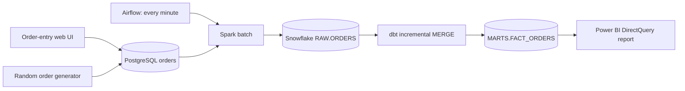

# Minute Market: a one-minute retail ELT learning demo

Pretend you run three coffee shops in Chicago. You want to watch revenue, transaction count, average basket size, and sales by store as purchases arrive. Customers place orders in a separate local web app. Those orders first land in PostgreSQL. Airflow moves them through Spark and Snowflake, then runs dbt. Power BI reads the resulting Snowflake facts.

This is a local learning project. All purchases are fictional. The source code contains plain-language comments explaining the main decisions.

## The journey of one order



1. A user submits an order at `http://localhost:8000`. The API validates its store, product, quantity, and discount, looks up its price on the server, and inserts it into PostgreSQL.
2. The row starts with `delivered_at = NULL`. That means it is waiting to be sent. PostgreSQL commits the row before the UI confirms the purchase.
3. Airflow schedules `retail_every_minute` at each minute boundary. Only one run may be active at a time.
4. Spark reads up to 5,000 undelivered orders through PostgreSQL JDBC. It removes duplicate IDs and standardizes the timestamp and column names. This demo intentionally keeps business calculations in dbt.
5. The Snowflake Python connector stages the bounded Spark result using `write_pandas`. A Snowflake `MERGE` inserts transaction IDs that are not already present in `RAW.ORDERS`.
6. Only after the Snowflake merge succeeds does the loader mark the PostgreSQL rows as delivered.
7. Airflow runs `dbt build`. The staging view reads RAW. The incremental fact model calculates gross revenue, discount amount, and net revenue. Tests check keys, required fields, and correct amounts.
8. Power BI DirectQuery asks Snowflake for the current facts when its visuals refresh. Keep the active report page on a one-minute automatic page refresh.

Example: two coffees at $4.50 each with a 10% discount produce $9.00 gross revenue, $0.90 discount, and $8.10 net revenue.

## What “every minute” means

Airflow starts a new batch every minute. This is a micro-batch pipeline, not streaming. Spark startup, loading, dbt, and report queries take additional time. Power BI refreshes on its own clock. An order placed just after a batch starts can wait for the next batch and then the next report refresh. Expect roughly one to two minutes plus processing time, rather than a guaranteed 60-second end-to-end deadline.

If a batch runs longer than a minute, `max_active_runs=1` prevents overlapping writes. The UI shows how many orders are waiting. The Power BI “Latest Order ID” card helps you confirm the particular order you submitted has reached the report.

## Files to read first

| File | What it teaches |
|---|---|
| `app/main.py` | Input validation, safe SQL inserts, and random purchase generation |
| `app/index.html` | The separate order-entry and simulator UI |
| `postgres/init.sql` | Source schema and the durable delivery queue |
| `pipeline/load_orders.py` | Reading PostgreSQL with Spark and loading Snowflake safely |
| `dags/retail_minute.py` | One-minute scheduling, task order, and retries |
| `dbt/models/marts/fact_orders.sql` | Incremental filtering and merging by transaction ID |
| `dbt/tests/valid_order_amounts.sql` | A business-data quality check |
| `sql/snowflake_setup.sql` | Warehouse, schemas, users, and restricted roles |
| `scripts/build_powerbi.py` | A commented generator for Power BI model/report JSON |
| `compose.yaml` | How the three local services run together |

## Prerequisites

- Docker Desktop running with Linux containers. Allow enough memory for PostgreSQL, Java/Spark, and Airflow; 6–8 GB available to Docker is a practical starting point.
- PowerShell and Git for Windows (its OpenSSL utility generates the service key).
- A Snowflake account with permission to run the one-time setup as `ACCOUNTADMIN`.
- Power BI Desktop. The supplied project uses PBIP/PBIR source files and a Snowflake DirectQuery model.
- Internet access for the first image build and for Snowflake.
- At least 10 GB of free disk space for image downloads, build layers, and data.

Airflow, Spark, and dbt Core run locally. They require no hosted vendor subscriptions. Snowflake still requires authentication and consumes warehouse credits. An X-Small warehouse queried every minute can remain active continuously. Stop the demo and close the Power BI report when finished.

## First-time setup

Open PowerShell in the project root. On this machine the project is under the chat's `outputs/retail-elt-demo` folder.

### 1. Create local settings

The `.env` file has already been created for the current machine. For a fresh clone:

```powershell
Copy-Item .env.example .env
```

Fill in your account identifier and your existing setup username. The warehouse/database/schema names are demo defaults created by the setup SQL. Do not create them manually in advance.

The actual `.env`, generated keys, and Power BI local caches are excluded from Git. `.env.example` documents the expected settings without real credentials.

### 2. Prepare and review Snowflake setup

```powershell
# Use the Snowflake username returned by CURRENT_USER(), which can differ from a login email.
.\scripts\Prepare-Snowflake.ps1 -ReportUsername 'your_actual_snowflake_username'
```

This generates `secrets/snowflake_key.p8`, its public key, and `secrets/setup.sql`. It does not connect to Snowflake. The private key is restricted to your Windows user and excluded from Git and the Docker build context. The running containers mount the project locally so they can read the key.

Review `secrets/setup.sql`, then run its statements in a Snowsight SQL file as `ACCOUNTADMIN`. It creates:

- `ELT_WH`: an X-Small warehouse with 60-second auto-suspend and auto-resume.
- `RETAIL_DEMO.RAW`, `STAGING`, and `MARTS`.
- `ELT_SERVICE` with key-pair authentication and a restricted `ELT_ROLE`.
- `RETAIL_REPORTER` with read-only access to reporting objects, granted to your interactive user.

Do not reuse these generic names for unrelated existing objects. The setup uses `IF NOT EXISTS`; it does not erase existing data. Registering the generated key updates the named service user's key, so retain this key for later starts.

After the SQL succeeds:

```powershell
.\scripts\Use-ServiceAccount.ps1
```

This changes `.env` to use `ELT_SERVICE` and `ELT_ROLE`. The pipeline never needs `ACCOUNTADMIN`.

### 3. Start the local demo

```powershell
.\scripts\Start-Demo.ps1
```

The script builds the Docker image, tests the service account against Snowflake, and starts PostgreSQL, the UI, and Airflow. It waits for the UI and scheduler health checks before reporting that startup succeeded. The first build downloads several large packages and can take several minutes. Airflow and dbt have separate Python environments inside the image to avoid dependency conflicts.

Open:

- Order UI: [http://localhost:8000](http://localhost:8000)
- Airflow: [http://localhost:8080](http://localhost:8080)

Airflow login and job:

1. **Username:** `demo`
2. **Password:** `demo_local_only`
3. **DAG:** `retail_every_minute`

After signing in, select `retail_every_minute` and open **Grid** to review each one-minute run. Each run shows the Spark loading task followed by the dbt models and tests. Green means the task succeeded; click a task to read its logs.

The PostgreSQL username/password in Compose and the Airflow login are deliberately local demo values. Ports are bound to `127.0.0.1`. Do not expose this setup on a shared network.

### 4. Make the first order and wait for dbt

Place a manual order in the UI. Save its order ID. The next Airflow run should show two successful tasks. That first run creates the reporting table Power BI needs.

You can also trigger an immediate run while learning:

```powershell
docker compose exec airflow airflow dags trigger retail_every_minute
```

The simulator initially stays off. Click **Start automatic orders** to generate one purchase every five seconds (or change the interval). Click it again to stop.

## Follow one order through the demo, step by step

Use this tutorial after completing the one-time setup above. Docker Desktop must be running, the Docker image must already be built, and the local `.env` and Snowflake service key must exist. The source database keeps its existing orders when the demo restarts.

### Step 1: start Airflow and its PostgreSQL dependency

Open PowerShell and enter the project folder. On this machine:

```powershell
# Work in the folder containing compose.yaml so Docker finds this demo's services.
cd "C:\Users\pcc20\Documents\Codex\2026-11-12\i-wa\outputs\retail-elt-demo"

# Start Airflow; Docker also starts PostgreSQL because Airflow depends on it.
# Wait until the services are healthy instead of assuming a started process is ready.
docker compose up -d --wait --wait-timeout 180 airflow

# Enable the one-minute schedule, including if you paused the DAG during an earlier exercise.
docker compose exec airflow airflow dags unpause retail_every_minute
```

You do not need to start a hosted Spark or dbt service. Airflow starts Spark for a batch and runs the installed dbt command after loading succeeds.

### Step 2: start and open the separate order UI

```powershell
# Start the order-entry server and wait until its API can answer requests.
docker compose up -d --wait --wait-timeout 180 orders-ui

# Confirm PostgreSQL, Airflow, and the order UI are running and healthy.
docker compose ps
```

Open [http://localhost:8000](http://localhost:8000). Leave automatic orders stopped for this exercise so your one purchase is easy to follow.

### Step 3: submit one purchase and remember its ID

Choose a store and product, enter a quantity, and click **Place order**. The page confirms an order number, such as `Order #42 saved to PostgreSQL.` Write down your actual number; `42` below is only an example.

For an easy amount to check, choose Coffee, quantity 2, and discount 10%. Its expected net revenue is $8.10. The UI shows **Waiting** until a loader acknowledges delivery to Snowflake RAW, then **Delivered**. Delivered does not yet prove dbt or Power BI has finished.

### Step 4: inspect the newest order in PostgreSQL

Run this from the same PowerShell window:

```powershell
# Read the purchase with the largest ID, which is normally the one you just submitted.
docker compose exec postgres psql -U demo -d retail -c "SELECT * FROM orders ORDER BY transaction_id DESC LIMIT 1;"
```

The SQL inside that command is:

```sql
-- Read the source table where the order-entry application saved the purchase.
SELECT *
-- Use our local retail database's orders table.
FROM orders
-- Put the newest assigned purchase ID first.
ORDER BY transaction_id DESC
-- Return one purchase instead of the entire history.
LIMIT 1;
```

Check `transaction_id`, `ordered_at`, store/product/quantity, and `delivered_at`. A blank `delivered_at` means the purchase has not yet been acknowledged by the loader. A timestamp means the Snowflake RAW merge succeeded. If the batch already ran before you queried, this field may already contain a timestamp.

If another order was submitted after yours, query your saved ID instead:

```powershell
# Replace 42 with the ID confirmed by your own order form.
$orderId = 42

# Read that exact purchase even if newer purchases have arrived.
docker compose exec postgres psql -U demo -d retail -c "SELECT * FROM orders WHERE transaction_id = $orderId;"
```

**How to exit the output:** if you see `(END)`, press **q** to close the scrolling results viewer and return to PowerShell. If you opened an interactive session and see `retail=#`, type **\q** and press Enter. With `psql -c`, the command otherwise exits by itself after printing the result. Closing this results viewer does not stop PostgreSQL or the pipeline.

### Step 5: find the order's batch in the Airflow website

Open [http://localhost:8080](http://localhost:8080) and sign in:

1. **Username:** `demo`
2. **Password:** `demo_local_only`
3. **DAG:** `retail_every_minute`

Open the DAG and select **Grid**. Find a run whose actual start time is after you submitted the purchase. Select the corresponding task cell, not a different run's task. Airflow displays task states with a color legend; **success** is green. A run in progress may show running or queued tasks until it finishes.

The run's ID can look one minute earlier than its actual start time: a scheduled run labels the minute interval that just ended. Match the actual start time and purchase ID instead of relying only on the timestamp inside the run ID. Airflow may display UTC unless you change its display timezone; compare timezone-aware timestamps carefully.

**First, inspect `spark_postgres_to_snowflake`:** select its task cell and open **Logs**. A batch containing your order prints messages like these:

```text
Delivered 1 orders to Snowflake RAW.
Loaded transaction IDs (first 50): [42]
```

These numbers are examples. Search the logs for your actual order ID. If that run says `No new orders. Nothing to load.`, look at the neighboring run: an earlier batch may already have delivered the purchase, or the next batch may pick it up. A batch that has already selected its IDs will not include a purchase submitted afterward.

**You can also inspect the task's small result:** look for **XCom** on the selected task. Depending on the UI layout, use **Admin → XComs** and filter by the DAG, task, and run instead. Inspect the key **`return_value`**. For one loaded order, the summary looks like:

```json
{
  "loaded_orders": 1,
  "transaction_ids": [42],
  "ids_truncated": false
}
```

The loader lists at most 50 IDs so Airflow's metadata stays small. `ids_truncated: true` means more orders were loaded than are listed. An empty batch returns a count of zero and an empty list. Runs from before this result-summary feature was added may have no such XCom.

**Second, inspect `dbt_incremental_models_and_tests`:** select its cell for the same run and open **Logs**. Check that `MARTS.fact_orders` succeeded, all data tests passed, and the command ended with return code 0. A RAW delivery followed by a failed dbt task means the purchase is loaded but the reporting layer still needs a successful transformation.

Yes, Airflow shows execution results: task state, start/end times, duration, logs, errors, retries, and this small batch summary. It does not automatically display the entire PostgreSQL or Snowflake table. The ID in the loading result identifies the purchase; query Snowflake below to inspect its actual transformed values.

### Step 6: confirm that exact purchase in Snowflake

In a Snowsight SQL worksheet, run this and replace `42` with your ID:

```sql
-- Find the original loaded row by its purchase ID.
SELECT *
-- Read the RAW table filled by Spark's loader.
FROM RETAIL_DEMO.RAW.ORDERS
-- Replace this sample ID with the number confirmed by your order form.
WHERE TRANSACTION_ID = 42;

-- Inspect the business calculations created by the dbt fact model.
SELECT TRANSACTION_ID, QUANTITY, UNIT_PRICE, DISCOUNT_PCT,
       GROSS_REVENUE, DISCOUNT_AMOUNT, NET_REVENUE,
       LOADED_AT, TRANSFORMED_AT
-- Read the reporting table, which is created after RAW loading succeeds.
FROM RETAIL_DEMO.MARTS.FACT_ORDERS
-- Use the same purchase ID so you compare the same row across both layers.
WHERE TRANSACTION_ID = 42;
```

For two coffees at $4.50 with a 10% discount, verify gross revenue $9.00, discount $0.90, and net revenue $8.10. Re-run the PostgreSQL query too: `delivered_at` should now be filled in. Another pipeline run should not create a second fact row with that transaction ID.

### Step 7: check the report and stop the demo afterward

After the Power BI dashboard layout and its automatic refresh have been verified, keep its DirectQuery page active and look for the same purchase ID after the next report refresh. PostgreSQL-to-Snowflake processing runs every minute, while report refresh happens on its own clock. A purchase can therefore take more than 60 seconds to appear in the report.

You can turn on automatic orders to watch repeated batches. Turn the simulator off before exact row-count/revenue comparisons. The current live validation status is recorded in [VALIDATION.md](VALIDATION.md); a working backend alone does not establish that the Power BI visuals are fully verified.

```powershell
# Stop the local services while keeping the PostgreSQL data volume.
.\scripts\Stop-Demo.ps1
```

Close the Power BI live report as well so it stops querying Snowflake and the warehouse can auto-suspend.

## Where dbt's ref() and source() are defined

A SQL file inside `dbt/models` defines a model. The filename without `.sql` is its model name. The SQL describes which rows and columns it should return; dbt's settings decide whether to create a view, a table, or an incremental table from that query.

- [stg_orders.sql](dbt/models/staging/stg_orders.sql) defines the model `stg_orders`. The staging settings in [dbt_project.yml](dbt/dbt_project.yml) create it as a view in `STAGING`.
- [fact_orders.sql](dbt/models/marts/fact_orders.sql) defines the model `fact_orders`. Its `config()` sets an incremental table that merges by `transaction_id`.
- `ref('stg_orders')` is a built-in dbt function that finds the model named `stg_orders`. In this demo, it fills in `RETAIL_DEMO.STAGING.STG_ORDERS` and tells dbt that this view must be ready before the fact model runs.
- `source('retail_raw', 'ORDERS')` is a built-in dbt function that looks up an existing input table declared in [sources.yml](dbt/models/sources.yml). `retail_raw` is an alias for that source group; `ORDERS` is a table listed beneath it. The database and schema in that YAML resolve the input to `RETAIL_DEMO.RAW.ORDERS`.

The flow is therefore `source('retail_raw', 'ORDERS') → stg_orders.sql → ref('stg_orders') → fact_orders.sql`. The column named `source` in the purchase data means manual/simulator and is unrelated to dbt's `source()` function.

### What starts when dbt build runs?

Airflow first changes its working directory to `/opt/demo/dbt`, then runs `dbt build --profiles-dir . --target demo` using the dbt environment's executable. The installed dbt command starts the tool; this project's starting configuration is [dbt_project.yml](dbt/dbt_project.yml), rather than one special entry-point SQL file.

| Part of the command or project | What it means in plain language |
|---|---|
| `dbt build` | Discover models and run them with their data tests. |
| Current directory `/opt/demo/dbt` | Find `dbt_project.yml` here. |
| `--profiles-dir .` | Read `profiles.yml` from this same directory. |
| `profile: retail_demo` | Select the matching connection-profile block in `profiles.yml`. |
| `--target demo` | Select `outputs.demo` inside that profile. |
| `model-paths: [models]` | Search `dbt/models` for the SQL files that define models. |
| `test-paths: [tests]` | Find the additional SQL data-quality checks in `dbt/tests`. |
| `ref()` relationships | Work out which models depend on which other models, so they run in a valid order. |

In this project, dbt reads RAW through `stg_orders`, builds `fact_orders` from that staging view, checks the fact data, and creates `sales_by_minute` from the fact model. The SQL inside those files defines the transformations. Airflow's DAG only starts the command and checks whether it succeeds.

### Step by step: how dbt knows what to run next

There is no `main.sql` or `demo.sql`. The installed dbt command starts the work. `demo` is only the name of a connection target in `profiles.yml`.

For example, from the project's `dbt` folder:

```bash
dbt run --profiles-dir . --target demo
```

1. **Read `dbt_project.yml`.** `profile: retail_demo` names the connection profile, and `model-paths: [models]` tells dbt where to find the SQL models.
2. **Read `profiles.yml`.** `--profiles-dir .` means the current folder. `--target demo` selects `retail_demo.outputs.demo`, which contains the Snowflake connection settings. It does not select a SQL file.
3. **Read the model files and discover dependencies.** In `fact_orders.sql`, `ref('stg_orders')` means staging must be ready first. In `sales_by_minute.sql`, `ref('fact_orders')` means the fact model must be ready first. The order comes from `ref()`, not alphabetical filenames.
4. **Compile and execute the models in dependency order.** dbt replaces `ref()` and `source()` with database object names. Materialization settings tell it to create a view, create a table, or merge incremental rows.

```text
RETAIL_DEMO.RAW.ORDERS       Existing table loaded by Spark
    |
    v
stg_orders.sql              Creates the staging view
    |
    v
fact_orders.sql             Creates or updates the incremental fact table
    |
    v
sales_by_minute.sql          Creates the summary view
```

`source('retail_raw', 'ORDERS')` identifies the existing RAW table through `models/sources.yml`; dbt does not load that table from PostgreSQL.

Airflow uses `dbt build --profiles-dir . --target demo`. It follows these same dependencies and also runs the data tests. Every minute, Airflow starts a new command after the Spark loading task succeeds. Later runs merge new arrivals into the existing fact table.

### Understand the dbt task logs: what each step does

dbt runs the SQL models to turn raw purchases into reporting data, then checks that the results are valid. Airflow's `dbt_incremental_models_and_tests` task uses `dbt build`, so its logs include both models and tests.

**1. Prepare the connection and discover the work.**

```text
Registered adapter: snowflake=1.9.2
Found 3 models, 6 data tests, 1 source, 476 macros
Concurrency: 2 threads (target='demo')
```

dbt finds the three SQL models, six checks, and RAW source declaration. It uses the Snowflake connection settings named `demo`. Two threads allow independent work to run at the same time. The macros are available helper functions, not 476 jobs being run. The macro count can change with installed packages and versions.

**2. Create the staging view.**

```text
START sql view model STAGING.stg_orders
```

dbt runs [stg_orders.sql](dbt/models/staging/stg_orders.sql) to create or replace `RETAIL_DEMO.STAGING.STG_ORDERS`. This view selects columns from `RAW.ORDERS` and sets their data types. A view stores a query; it does not copy the orders into another table.

**3. Update the reporting table.**

```text
START sql incremental model MARTS.fact_orders
```

dbt runs [fact_orders.sql](dbt/models/marts/fact_orders.sql). It reads the staging view and calculates gross revenue, discount amount, and net revenue. For example:

| Purchase or calculation | Value |
|---|---|
| Quantity | 2 |
| Unit price | $4.50 |
| Discount | 10% |
| Gross revenue: quantity multiplied by unit price | $9.00 |
| Discount amount: gross revenue multiplied by 10% | $0.90 |
| Net revenue: gross revenue minus discount amount | $8.10 |

On the first run, dbt creates the fact table. On later runs, it selects arrivals using `loaded_at` and merges them by `transaction_id`. Existing historical rows remain in the table. The filter includes equal loading timestamps, so a later run can recheck some rows; the merge prevents duplicate transaction IDs.

**4. Check the reporting data.**

```text
PASS not_null_fact_orders_net_revenue
PASS unique_fact_orders_transaction_id
```

The six tests check that revenue, order time, and transaction ID are not missing; transaction IDs are unique; transformation timestamps do not precede loading timestamps; and order amounts satisfy the rules in the test SQL. These tests check the resulting data. They do not calculate or fix it. `PASS` means the test found no rows that violate its rule.

**5. Create the sales summary view.**

```text
START sql view model MARTS.sales_by_minute
```

dbt runs [sales_by_minute.sql](dbt/models/marts/sales_by_minute.sql). This view groups the fact table by minute and store to show order counts, items sold, and total revenue. In the example log it runs after the fact tests; dbt can schedule independent work concurrently, so use the `ref()` dependencies to understand the required model order.

**6. Report success back to Airflow.**

```text
PASS=9 WARN=0 ERROR=0 SKIP=0 TOTAL=9
Command exited with return code 0
```

All three models and six tests succeeded: nine operations in total. Return code `0` tells Airflow the command succeeded, so it marks the task green. A model line such as `SUCCESS 2` is an adapter execution result; it does not necessarily mean two newly added orders, because a merge can also affect rows already present.

The transformed rows stay in Snowflake. These logs show whether the work succeeded; they do not print the order rows. To inspect the actual results in a Snowflake worksheet:

```sql
-- Show the latest purchases after dbt calculated revenue and discounts.
SELECT *
FROM RETAIL_DEMO.MARTS.FACT_ORDERS
ORDER BY TRANSACTION_ID DESC
LIMIT 10;

-- Show the sales totals grouped by minute and store.
SELECT *
FROM RETAIL_DEMO.MARTS.SALES_BY_MINUTE
ORDER BY ORDER_MINUTE DESC
LIMIT 10;
```

### Open the Snowflake SQL editor and see your orders

Start with these steps if you do not know where to enter SQL:

1. Open [the demo account's existing Untitled.sql editor](https://app.snowflake.com/cqclxxg/ef86683/#/workspaces/ws/USER%24/PUBLIC/DEFAULT%24/Untitled.sql). Sign in to Snowflake if needed. This link is specific to the account used for this demo.
2. Find the **Untitled.sql** tab. The large area containing SQL text is the editor. The database list on the left is for browsing objects; enter your query in the editor.
3. Click inside the SQL text area. Press **Ctrl+A** to select the existing SQL, then replace it with the query below. Replacing the text does not undo SQL that was already executed.

```sql
-- Choose the Snowflake compute warehouse that will execute this query.
USE WAREHOUSE ELT_WH;

-- Read the latest ten orders after dbt calculated revenue and discounts.
SELECT *
FROM RETAIL_DEMO.MARTS.FACT_ORDERS
ORDER BY TRANSACTION_ID DESC
LIMIT 10;
```

4. While your cursor is inside the SQL editor, press **Ctrl+A** again to select both statements. Click **Run selected** above the editor.
5. Look at the **Results** area underneath the editor. The SELECT result shows the latest ten transformed orders. If the result shown is only the warehouse-selection message, select just the `SELECT` statement and run it again.

`ELT_WH` is the compute warehouse that executes SQL. `RETAIL_DEMO` is the database, `MARTS` is the schema, and `FACT_ORDERS` is the reporting table. Using the full table name means you do not have to select the database and schema separately.

If the existing-file link no longer opens the editor, click **Workspaces** in Snowflake's left navigation. Open **My Workspace**, use **Add new** or the **New file** button, and choose a SQL file. Paste and run the same query there.

## Connect Power BI Desktop

The generated project lives at `powerbi/RetailDemo.pbip`. Its semantic model uses Snowflake DirectQuery against `RETAIL_DEMO.MARTS.FACT_ORDERS`; its report includes revenue, transaction count, average basket, latest order ID, revenue over time, store comparison, and order detail.

1. Open `powerbi/RetailDemo.pbip` in Power BI Desktop after the first dbt run succeeds. If Desktop requires its project-format preview setting, enable the relevant PBIP/PBIR feature and restart when prompted.
2. Authenticate the Snowflake source when Desktop asks. If you normally sign into Snowflake with Google and have no password, choose **KeyPair** and enter username **ELT_SERVICE**. If the dialog shows a large **Private Key** text box, open the local file `secrets/snowflake_key.p8` in a text editor, copy its entire contents including the BEGIN/END lines, and paste those contents into that box. Do not paste the file path there. If your version instead provides a file picker, select that file. Leave **Passphrase** blank because this demo key is unencrypted. The setup grants this user `RETAIL_REPORTER`, and the report activates that read-only role. Power BI keeps credentials locally, not in the Git project. A Google browser login does not automatically authenticate Power BI. You must complete the authentication dialog yourself. Never paste the private key into chat or commit it to GitHub.
3. The source settings are the account's server hostname, warehouse `ELT_WH`, and role `RETAIL_REPORTER`. The report generator fills the server for this machine. For another account, run `python scripts/build_powerbi.py --server your-account.snowflakecomputing.com` before opening it.
4. Select the report's blank canvas. In the page formatting pane, open **Page refresh**, enable **Auto page refresh**, and set its interval to **1 minute**. Save the project. Keep the report page active during the demo.
5. Place another manual order in the UI. After the Airflow run and the next automatic page refresh, find the same ID in the report. This verifies the complete path.

The one-minute interval applies to the active Desktop report page. A published report in shared/Pro capacity has a 30-minute minimum automatic page refresh. Faster published refresh needs appropriate capacity and administrator settings. This demo targets the installed Desktop app, not pinned Power BI service dashboard tiles.

If opening a generated project fails, the manual equivalent is **Get data → Snowflake**, specify the server and `ELT_WH`, choose **DirectQuery**, and select `RETAIL_DEMO → MARTS → FACT_ORDERS`. The measures and visual definitions are available in `scripts/build_powerbi.py`.

## What makes retries safe?

The order API accepts a request UUID. Retrying the same request returns the same order instead of inserting another purchase. The loader remembers undelivered rows in PostgreSQL rather than assuming all IDs below the latest ID have already committed. Snowflake merges by transaction ID. If it loads an order but crashes before marking it delivered, the next run replays the order without inserting a duplicate.

The dbt fact model uses `loaded_at`, rather than the original purchase time, to select new arrivals. The `>=` comparison deliberately includes equal timestamps; its merge key prevents duplicate facts. If loading succeeds but dbt fails, a subsequent `dbt build` can still catch up from RAW even if there are no more new PostgreSQL orders.

This demo supports immutable purchases. It does not implement purchase edits, deletions, refunds, or full change-data capture. Those would need an update/change log and different merge rules.

## Useful commands

```powershell
# Check running services and recent task output.
docker compose ps
docker compose logs --tail 80 airflow
docker compose logs --tail 40 orders-ui

# Check PostgreSQL without opening an additional database tool.
docker compose exec postgres psql -U demo -d retail -c "SELECT transaction_id, product, delivered_at FROM orders ORDER BY transaction_id DESC LIMIT 10;"

# Test the exact automated Snowflake connection (browser authentication is separate).
docker compose run --rm --no-deps orders-ui python scripts/test_snowflake.py

# Check that retrying an API request does not create another purchase.
python scripts/smoke_test.py

# Stop automatic purchases, wait for a successful batch, then reconcile real data.
docker compose exec orders-ui python scripts/verify_warehouse.py

# Re-run incremental models and their tests.
docker compose exec airflow bash -c 'cd /opt/demo/dbt && /home/airflow/dbt-venv/bin/dbt build --profiles-dir .'

# A deliberate full rebuild is useful for learning after changing model SQL.
docker compose exec airflow bash -c 'cd /opt/demo/dbt && /home/airflow/dbt-venv/bin/dbt build --profiles-dir . --full-refresh'

# Stop local containers while keeping PostgreSQL data.
.\scripts\Stop-Demo.ps1
```

Close Power BI's live report too, so it stops querying Snowflake and the warehouse can suspend. Do not use `docker compose down -v` unless you intend to erase local PostgreSQL orders and Airflow history.

## Troubleshooting

| Symptom | What to check |
|---|---|
| Docker engine unavailable | Start Docker Desktop and wait for Linux containers to be ready. |
| Key file missing or JWT rejected | Run setup and ensure `.env` uses the service user whose public key was registered. |
| Warehouse/schema not found | Run the complete setup SQL and verify `ELT_ROLE` is active for the pipeline. |
| UI says Delivered but Power BI is behind | RAW delivery is earlier than dbt. Check the dbt task, then the report's page-refresh settings. |
| Airflow DAG missing | Inspect scheduler logs or run `airflow dags list-import-errors` in the container. |
| Orders stay Waiting | Check the Spark task's logs and the Snowflake connection test. |
| Power BI table not found | Wait for the first successful `dbt build`. |
| Power BI refresh setting missing | Confirm the model is DirectQuery, and select the page rather than a visual. |
| Airflow stops after starting | Inspect both scheduler and webserver logs; its start script exits if either stops. |

## Official references

- [Snowflake key-pair authentication](https://docs.snowflake.com/en/user-guide/key-pair-auth)
- [Power BI Snowflake connector](https://learn.microsoft.com/en-us/power-query/connectors/snowflake)
- [Power BI automatic page refresh](https://learn.microsoft.com/en-us/power-bi/create-reports/desktop-automatic-page-refresh)
- [Power BI project source files](https://learn.microsoft.com/en-us/power-bi/developer/projects/projects-overview)
- [Airflow Docker quick start](https://airflow.apache.org/docs/apache-airflow/2.10.5/howto/docker-compose/index.html)
- [Airflow task-result summaries with XCom](https://airflow.apache.org/docs/apache-airflow/2.10.5/core-concepts/xcoms.html)
- [dbt incremental models](https://docs.getdbt.com/docs/build/incremental-models)
