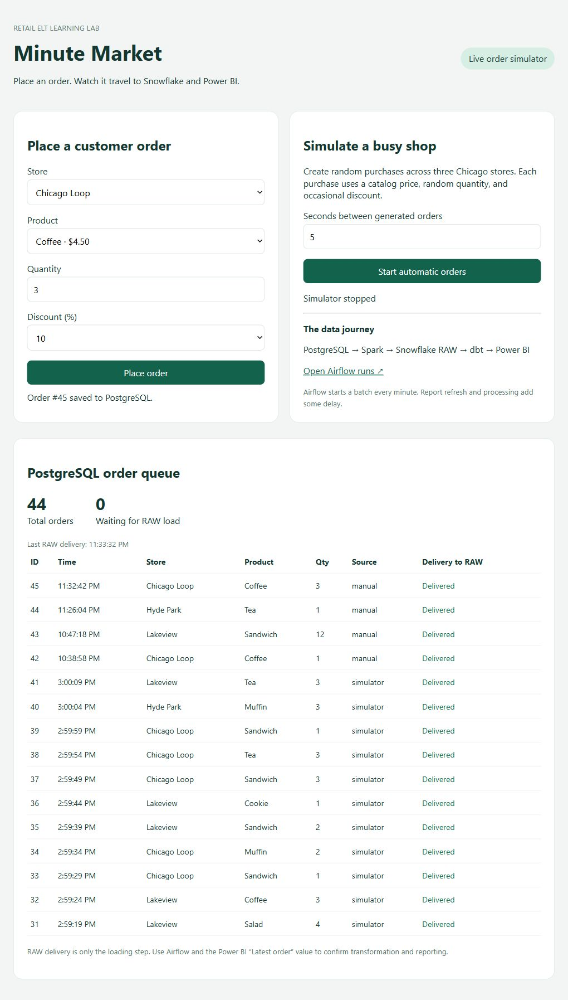
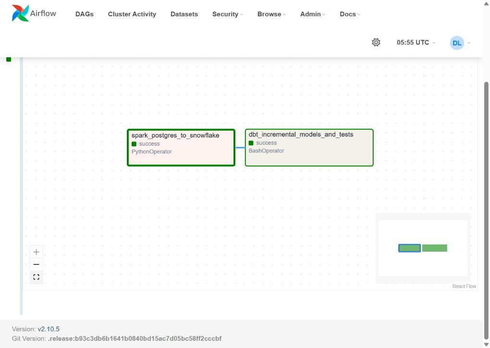
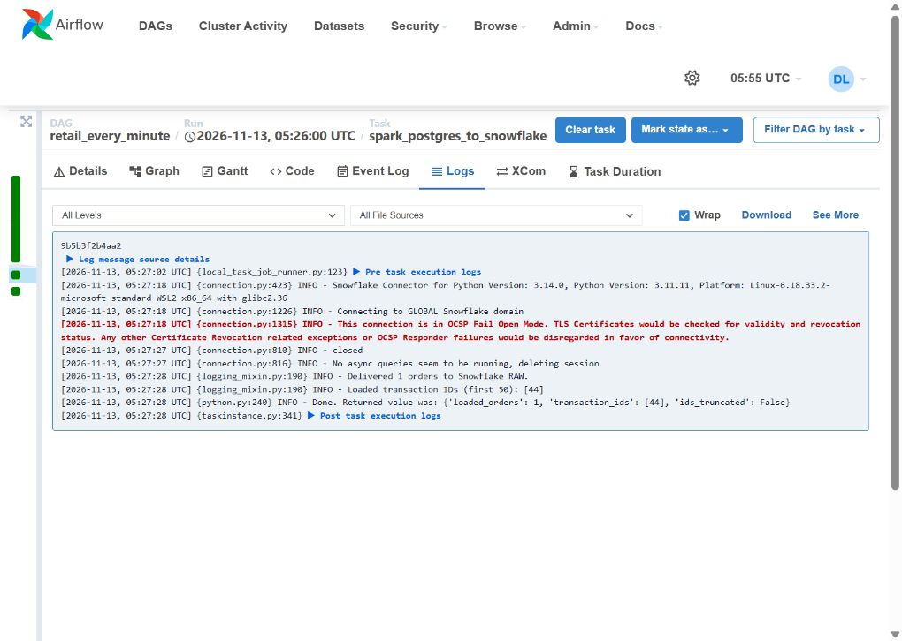
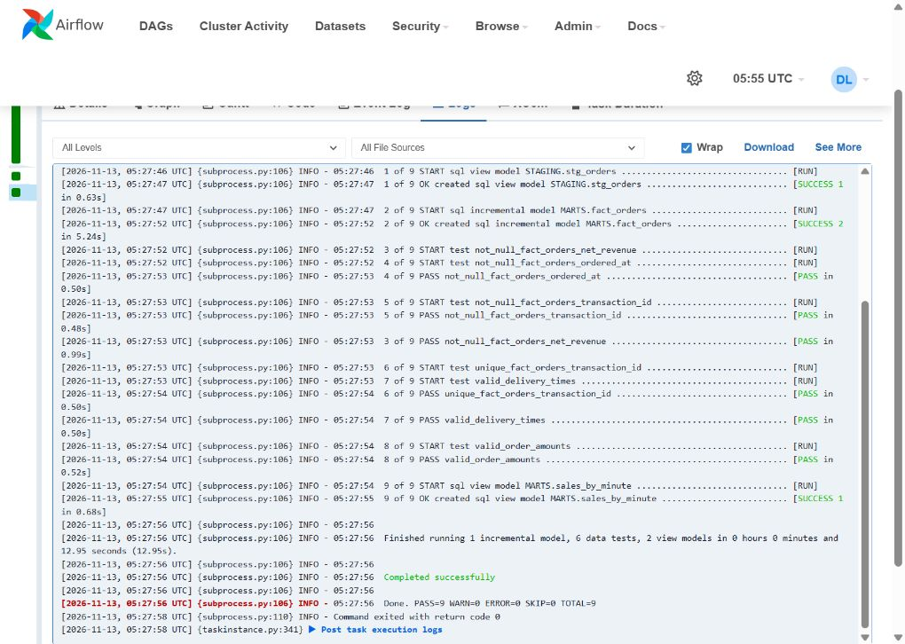
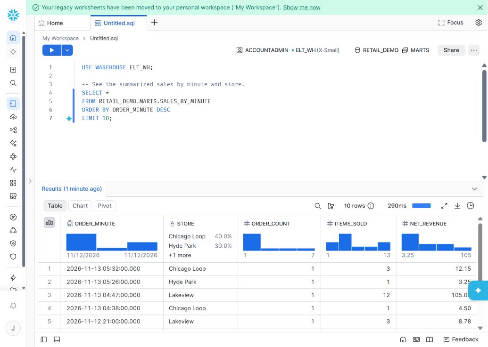

# From Coffee Orders to Snowflake: Building a One-Minute ELT Learning Project

## A practical walkthrough with PostgreSQL, Spark, Airflow, dbt, and an optional Power BI report

What happens between a customer clicking “Place order” and a sales number changing in a report?

I built Minute Market to make that journey visible. It simulates three coffee shops in Chicago. A separate web interface accepts fictional purchases, PostgreSQL stores them, and an Airflow workflow sends pending orders through Spark into Snowflake every minute. dbt then turns those raw purchases into tested reporting data.

The source code and a step-by-step demo guide are available on GitHub:
https://github.com/jwangdbe/retail-elt-demo

This is a learning project with deliberately small batches. The PostgreSQL-to-Snowflake ELT backend has been exercised with scheduled runs and data checks. Power BI is an optional extension; the repository includes manual instructions, but the complete dashboard refresh path has not been verified.

## Start with a business question

A coffee-shop owner wants to know how many purchases each store receives and how much revenue those purchases produce. A useful demo needs more than a static CSV: it needs an order you can submit yourself and follow through each stage.

For example, two coffees at $4.50 each with a 10% discount should produce:

```text
Calculation                  Amount
---------------------------  ------
Gross: 2 x $4.50              $9.00
Discount: $9.00 x 10%         $0.90
Net: $9.00 - $0.90            $8.10
```

That small example becomes an end-to-end check. Did the source save the purchase? Did the loader deliver it? Did the reporting model calculate $8.10?

## Give every tool a clear job

```text
Order UI / synthetic generator
             |
             v
      PostgreSQL orders
             |
       Spark micro-batch
             |
             v
 Snowflake RAW.ORDERS_BATCH
             |
           MERGE
             v
     Snowflake RAW.ORDERS
             |
             v
     dbt STAGING.STG_ORDERS
             |
             v
      dbt MARTS.FACT_ORDERS
             |
             v
   dbt MARTS.SALES_BY_MINUTE
             |
             v
   Optional Power BI report

Airflow schedules the load, then dbt.
```

PostgreSQL is the transactional source. The FastAPI order application validates input, looks up the price on the server, and saves each order. An optional generator creates synthetic purchases so the pipeline has activity without repeated manual clicks.

Spark reads the selected orders through JDBC, removes duplicate transaction IDs within the batch, standardizes timestamps, and uppercases column names. Spark is intentionally modest here: it prepares the loading shape, while business calculations live in dbt. See the Apache Spark JDBC documentation: https://spark.apache.org/docs/3.5.4/sql-data-sources-jdbc.html

Snowflake stores the RAW purchases and executes the transformation SQL. Its warehouse is the compute resource that runs the queries; its database and schemas organize the objects.

dbt Core manages the SQL models, their dependencies, incremental materialization, and data tests. Airflow manages when these steps run and whether they succeeded. Docker Compose packages the local services so the demo is easier to start and stop.

## Incremental extraction starts with a delivery queue

The loader does not reread the entire source table every minute. It first selects a bounded group of undelivered purchases:

```sql
-- NULL means the loader has not acknowledged delivery yet.
SELECT transaction_id
FROM orders
WHERE delivered_at IS NULL
ORDER BY transaction_id
LIMIT 5000;
```

Spark reads the selected IDs. Why not just remember the largest transaction ID? A transaction with a lower ID can commit after a higher one. Tracking pending delivery avoids treating ID order as proof of commit order.

The next detail is easy to miss: Spark does not directly write this demo into Snowflake using a distributed Snowflake connector. The bounded Spark result is converted to pandas, and the Snowflake Python connector uploads it with write_pandas.

```python
# This demo limits each batch so it fits in driver memory.
data = frame.toPandas()

# Load a batch table before merging into the permanent RAW table.
success, _, count, _ = write_pandas(
    warehouse, data, 'ORDERS_BATCH', schema='RAW'
)
```

That is useful for learning, but it is not a large-scale loading design. Larger workloads need a loading approach that avoids collecting all batch data into the driver's memory.

## Make retries safe

The loader merges the batch into RAW.ORDERS using transaction_id. A missing ID is inserted; an ID already present is left alone.

Only after the Snowflake merge succeeds does the loader set delivered_at in PostgreSQL. If the process crashes after the merge but before that acknowledgement, the next attempt can read the same purchase again. The merge prevents that replay from creating another RAW row.

This is retryable delivery with deduplication, not a distributed transaction across two databases. The order API also uses a unique request ID so retrying the same submission does not create another purchase.

## How dbt knows which SQL file comes first

Airflow runs this command from the dbt project folder:

```bash
dbt build --profiles-dir . --target demo
```

There is no demo.sql. The name demo selects a connection target in profiles.yml.

dbt reads dbt_project.yml, discovers models under models/, and builds a dependency graph from their references. The staging model reads the existing RAW input:

```sql
-- The source name and table are declared in models/sources.yml.
from {{ source('retail_raw', 'ORDERS') }}
```

The fact model depends on staging:

```sql
-- This dependency tells dbt staging must be ready first.
from {{ ref('stg_orders') }}
```

The final summary depends on the fact model:

```sql
{{ config(materialized='view') }}

-- Group purchases into minute/store reporting rows.
select order_minute, store, count(*) as order_count,
       sum(quantity) as items_sold, sum(net_revenue) as net_revenue
from {{ ref('fact_orders') }}
group by order_minute, store
```

The result, RETAIL_DEMO.MARTS.SALES_BY_MINUTE, is a view. A row represents a minute/store group rather than an individual purchase.

## Incremental transformation is a second, separate decision

Incremental extraction from PostgreSQL and incremental transformation in dbt solve different problems.

The fact model uses an incremental merge keyed by transaction_id. On later runs, its SQL filters using the RAW loading timestamp:

```sql

-- Recheck equal timestamps; the merge key prevents duplicate facts.
where loaded_at >= (
    select coalesce(max(loaded_at), '1900-01-01'::timestamp_ntz)
    from {{ this }}
)

```

Using loading time rather than purchase time allows an old purchase that arrives late to be processed. The first run creates the table; later runs process the selected arrivals and merge them into the existing data. Details of dbt's incremental materialization are documented here: https://docs.getdbt.com/docs/build/incremental-models

The project supports immutable purchases. Updating or deleting an old order would require additional change tracking and merge rules; this is not a general CDC implementation.

## Airflow makes each batch inspectable

The DAG uses a one-minute cron schedule, disables historical catch-up, and permits one active run at a time. That last setting matters because the loader uses a shared batch table.

```python
# Schedule a batch every minute.
schedule='* * * * *'

# Prevent overlapping runs from sharing the same batch table.
max_active_runs=1

# Load successfully before starting transformations and tests.
load >> transform
```

This excerpt shows the relevant settings and dependency, not a standalone DAG file. The complete implementation is in dags/retail_minute.py.

In Airflow, the loading task prints transaction IDs and returns a small XCom summary. The dbt task reports three models and six tests. Those tests check required fields, unique IDs, order amounts, and transformation timing. A successful log reports nine successful operations, not nine purchases. The actual rows remain in the databases.

## Authentication without embedding a password

The project generates an RSA private/public key pair locally. Generating keys does not grant Snowflake access.

During one-time setup, an already authenticated Snowflake administrator registers the public key on the ELT_SERVICE user and grants its demo role. Later, the connector uses the private key to sign authentication tokens that Snowflake verifies. dbt reads the account, user, role, warehouse, and key path from environment variables through profiles.yml.

Private keys, the actual .env file, and local Power BI credential caches are excluded from Git. If you adapt this project, use your own Snowflake account and register your own key.

## Try the demo before adding a dashboard

Start Docker Desktop, then run the repository's startup script from the project root after completing the documented Snowflake setup:

```powershell
# Start the demo services and check readiness.
.\scripts\Start-Demo.ps1
```

Open the order UI at localhost:8000 and place one purchase. In Airflow at localhost:8080, open retail_every_minute and inspect the next completed run. Then use a Snowflake SQL editor to read the final summary:

```sql
-- Choose the compute resource for the query.
USE WAREHOUSE ELT_WH;

-- Inspect the final dbt summary view.
SELECT *
FROM RETAIL_DEMO.MARTS.SALES_BY_MINUTE
ORDER BY ORDER_MINUTE DESC, STORE
LIMIT 10;
```

For an individual transaction ID, query MARTS.FACT_ORDERS instead. The README walks through PostgreSQL checks, Airflow logs, and Snowflake queries step by step.

## Add Power BI only when you need the visual layer

The optional manual report connects to SALES_BY_MINUTE using DirectQuery. Its simplest version has a total revenue card, a total orders card, and a table of minute/store groups. Use Sum of ORDER_COUNT, not Count of ORDER_COUNT: counting summary rows counts groups, not purchases.

A one-minute automatic page refresh can query the current Snowflake results while the Desktop report page is active. Airflow scheduling and report refresh are separate clocks, so one-minute batches do not guarantee a 60-second end-to-end update. Allow roughly one to two minutes plus processing time. Microsoft's Desktop refresh guidance explains the requirements and published-capacity restrictions: https://learn.microsoft.com/en-us/power-bi/create-reports/desktop-automatic-page-refresh

The pipeline can be demonstrated without Power BI. Seeing the expected order and revenue in Snowflake already proves the ELT path; dashboard refresh requires its own verification.

## What this project teaches

The useful lesson is how the boundaries fit together: a committed purchase becomes a pending delivery, a retry-safe RAW row, a tested fact, and finally a minute/store summary.

For a handful of coffee orders, Spark and a multi-tool stack are more machinery than necessary. Here that machinery is intentional: it creates a small environment where you can learn orchestration, loading, warehouse SQL, dependencies, and incremental processing separately.

Try submitting one order and tracing its ID before turning on the generator. That single purchase makes the entire pipeline easier to understand.

Source code and full tutorial: https://github.com/jwangdbe/retail-elt-demo

Cover illustration generated with AI for this article.

## 📸 Follow the demo, step by step

These screenshots show the running learning environment. The order UI and the illustrated Airflow run were captured at different moments; use transaction IDs when tracing one specific purchase.

### ☕ Step 1: submit an order

The separate order UI saves purchases in PostgreSQL. The queue shows how many orders are still waiting for delivery to Snowflake RAW.



### ⚙️ Step 2: inspect the workflow

Airflow connects the Spark loading task to the dbt build task. Both tasks in this captured run succeeded.



### 📥 Step 3: inspect the delivered transaction

The Spark task log confirms that transaction 44 was delivered to Snowflake RAW. The small returned summary is also available through XCom.



### ✅ Step 4: check the dbt models and tests

The transformation task builds three models and runs six tests. PASS=9 and return code 0 confirm successful execution; they are not a count of orders.



### ❄️ Step 5: query the final sales summary

Snowflake displays SALES_BY_MINUTE grouped by minute and store. A new purchase adds a group or changes the count, quantity, and revenue of an existing group.


